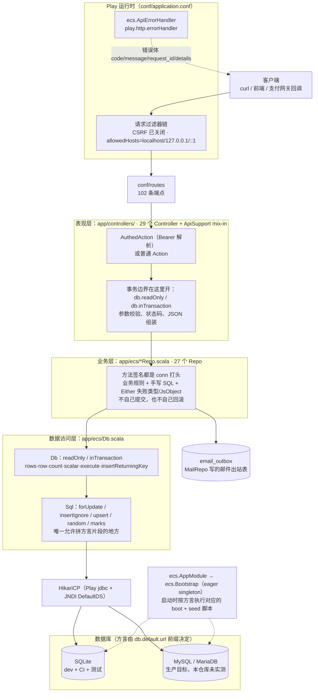
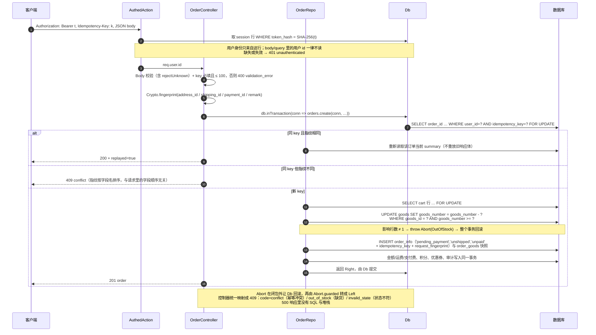
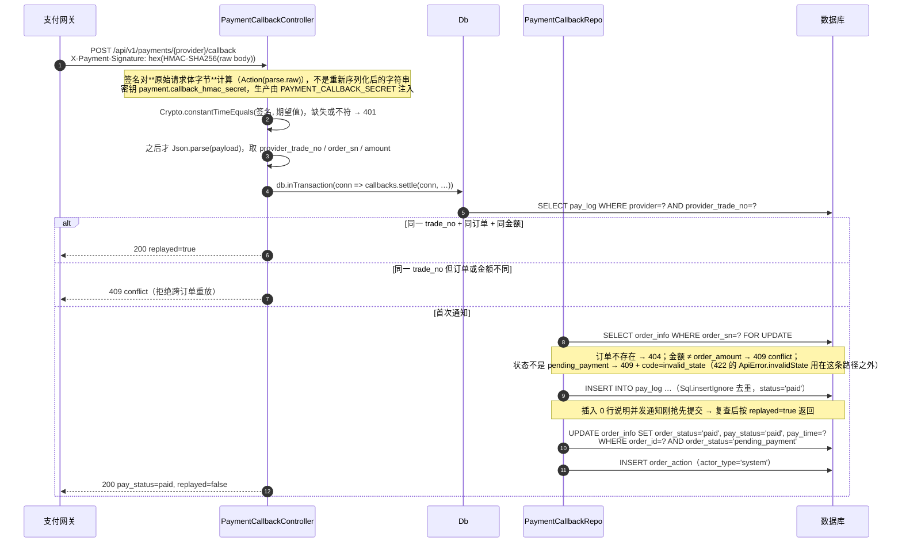
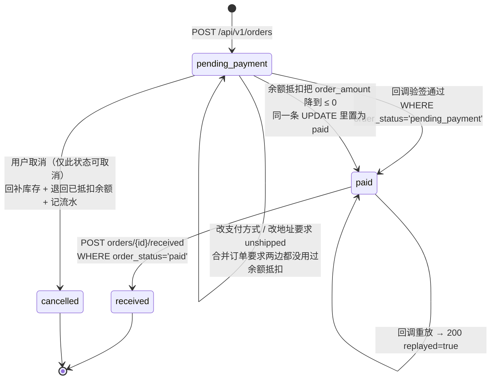
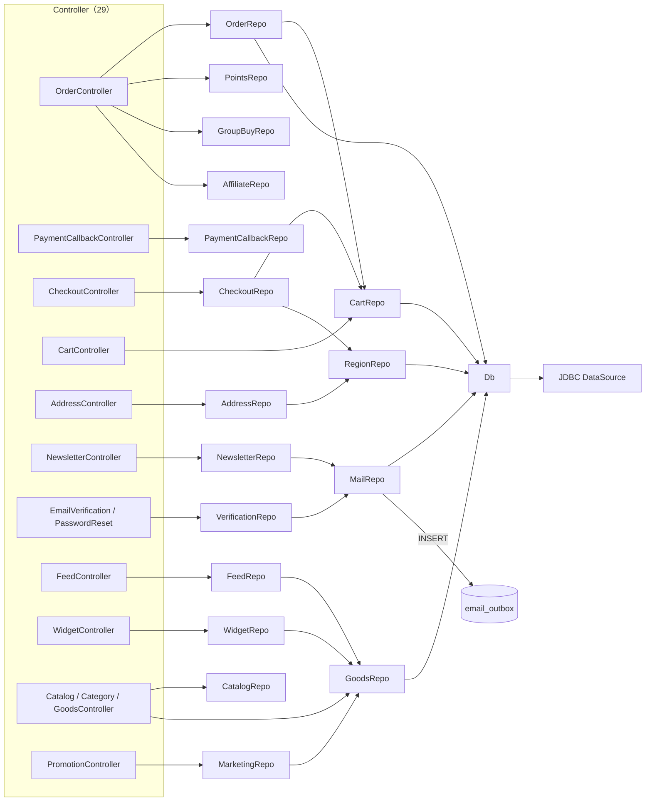
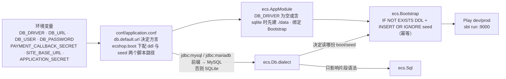

# Scala Play 实际架构图

本文的每张图都由**当前代码**反推而来，不是设计愿景：`app/`、`conf/routes`、`conf/application.conf`
里能找到的东西才会出现在图上。图后附有对应的核对命令。

对照说明：[04_architecture.md](04_architecture.md) 描述的是更早的 C++ 方案（Crow + Redis +
UseCase/Handler 分层，订单还有 `shipped`、`refunding` 写入路径）。那套东西本仓库没有实现，
本文取代它在 Scala 侧的位置；04 原文保持不动。

## 一、分层总览



横切工具不属于任何一层，被上层广泛复用（引用文件数由 `grep -rl` 实测）：

| 工具 | 位置 | 职责 | 被引用文件数 |
|---|---|---|---|
| `ApiJson` | `ecs/ApiError.scala` | 金额两位小数字符串、分/元换算、UTC 时间、`page()` 信封 | 31 |
| `Paging` | `ecs/Auth.scala` | 分页（默认 20、上限 100）+ `sort` 白名单 | 28 |
| `Body` | `ecs/Auth.scala` | 请求体取字段：`str/optStr/long/cents/bool/ids/rejectUnknown` | 21 |
| `Sql` | `ecs/Db.scala` | 方言片段（锁、忽略插入、upsert、随机排序） | 18 |
| `Views` | `ecs/Views.scala` | 商品价/摘要/时间戳的共享渲染 | 17 |
| `Crypto` | `ecs/Crypto.scala` | PBKDF2 口令、Bearer token、SHA-256、HMAC、常量时间比较、指纹 | 8 |
| `Abort` | `ecs/Abort.scala` | 在事务闭包内抛出以触发回滚，`Abort.guarded` 转成 `Left` | 6 |

一个和常见 Play 教程不同的约定：**事务边界属于 Controller**。读路径写
`db.readOnly(conn => repo.xxx(conn, …))`，写路径写
`Abort.guarded(db.inTransaction(conn => repo.xxx(conn, …)))`，27 个 Repo 的方法签名因此一律以
`conn: Connection` 开头，自己不提交也不回滚；跨 Repo 复用（如 `OrderRepo` 调
`CartRepo.pricedLines`）靠的是把同一个 `conn` 传下去，而不是各自开连接。
唯一把 SQL 片段写在 Controller 里的是 `CategoryController`，它用 `Sql.marks(n)` 生成 `IN (?)`
占位符串，值仍然全部走绑定参数。

核对：

```bash
grep -cE "^(GET|POST|PUT|PATCH|DELETE|HEAD|OPTIONS) " conf/routes     # 102
ls app/controllers/*.scala | wc -l                                     # 30 个文件：29 个 Controller + ApiSupport.scala
ls app/ecs/*Repo.scala | wc -l                                         # 27
grep -rhoiE "CREATE TABLE" conf/sql/sqlite_boot.sql | wc -l             # 53 张表
```

## 二、一次下单请求的完整生命周期

`POST /api/v1/orders` 是最能体现约束的路径：身份只来自 token、写操作在事务里、库存用条件
UPDATE、幂等靠 key + 指纹。



## 三、支付回调的结算路径

回调是系统里唯一被外部触发的写路径，所以它绕开 JSON 解析器直接吃原始字节。



回调没有任何库存扣减或积分发放的副作用 —— 那些都在下单事务里已经完成了；回调只做「标记已付 +
留凭证」。两处 `throw Abort` 会让整个回调事务回滚，网关拿不到成功语义就会重试，这正是想要的行为。

`PaymentCallbackController` 是**唯一**直接注入 `play.api.Configuration` 的控制器，为的就是读
`payment.callback_hmac_secret`；另一个读配置的是 `ecs.FeedRepo`（拼 feed 的绝对 URL）。

原始 payload **不写应用日志**（代码注释里明确了原因：它带 trade number 和精确金额），但它会原样
存进 `pay_log.raw_payload` 供对账 —— 排查时看的是表，不是日志。

## 四、真实的订单状态机

只有下图这些迁移在代码里存在。`shipped` 只在读侧出现（`order_info.shipping_status`），
没有任何写入路径 —— 后台发货不在本仓库范围内。



| 迁移 | 触发端点 | 守卫条件 |
|---|---|---|
| 创建 | `POST /api/v1/orders` | 幂等 key + 库存条件 UPDATE |
| → `paid` | `POST /api/v1/payments/{provider}/callback` | `order_status='pending_payment'` |
| 余额抵扣 | `PATCH /api/v1/me/orders/:id/surplus` | `pending_payment` 且 `pay_status='unpaid'`，`available_cents >= ?` |
| → `cancelled` | `POST /api/v1/me/orders/:id/cancel` | `order_status='pending_payment'`；订单行保留为 `cancelled`，只删 `order_balance_payment` |
| → `received` | `POST /api/v1/me/orders/:id/received` | `order_status='paid'` |
| 改支付方式 | `PATCH /api/v1/me/orders/:id/payment` | `pending_payment` 且 `shipping_status='unshipped'`，并且新的 `pay_id` 必须与当前不同、且 `enabled = 1` |
| 改地址 | `PATCH /api/v1/me/orders/:id/address` | `pending_payment` 且 `shipping_status='unshipped'` |
| 合并订单 | `POST /api/v1/me/orders/merge` | 两单都是自己的 `pending_payment`、都还没用过余额抵扣、且不是同一单；合并后两条原订单行被删除 |
| 重新加入购物车 | `POST /api/v1/me/orders/:id/cart` | 不校验状态，也不改状态，只把仍可售的商品合回购物车 |

## 五、依赖注入关系

Controller 只依赖 `Db`/`AuthedAction` 与若干 Repo；Repo 之间只有下面这几条真实注入边，
其余 19 个 Repo 的构造函数只有 `Db`。没有 ORM，没有 service 层。



每个 Repo 都以 `Db` 作为构造参数，图上底部只画了 5 条示例边，否则 27 条线会糊成一团；
`CatC` 一个节点代表 `CatalogController`（`CatalogRepo` + `GoodsRepo`）、`CategoryController`
和 `GoodsController`（后两个只用 `GoodsRepo`）。

`ecs/ApiSupport.scala` 是共享 mix-in（29 个 Controller 全部 `with ApiSupport`；状态码助手、
错误构造、`notReady`），不是运行时依赖，所以不在图上。`grep -rn "notReady(" app/` 现在只剩它自己的定义，
说明 102 条端点全部有实现。`README.md` 目录结构里写的「30 controllers」数的是
`ls app/controllers/*.scala` 的文件数，那个多出来的文件就是这份 mix-in。

## 六、HTTP 接口面

102 条端点按用途分桶，非 `/api` 的 5 条是 PHP 时代遗留的入口脚本：

| 分组 | 数量 | 覆盖范围 |
|---|---|---|
| `/api/v1/me**` 账户域 | 49 | 资料与密码、购物车、地址、余额与提现、红包、收藏、标签、预订、评论、留言、订单全套、团购、推广分成、浏览历史 |
| 商品读取与试算 | 5 | `goods` 列表、详情、价格试算、`compare`、`quotation` |
| 商品互动 | 4 | 评论读取/写入、商品标签、图集 |
| 促销与活动 | 11 | `promotions`、`activities`、`packages`、`topics`、`votes`、`exchange-goods`、`ads` |
| 认证与凭据恢复 | 8 | `auth` 注册/登录/登出/可用性探测、邮箱验证、密码重置 |
| 目录与内容 | 7 | `home`、`catalog`、分类商品、品牌列表与品牌商品、文章与分类文章 |
| 社区与辅助读取 | 9 | newsletter 订阅与退订及确认、`messages`、`tags` 云、`shipping-options`、`regions` |
| 结算与下单 | 4 | `checkout/options`、`checkout/quote`、`POST /api/v1/orders`、`POST /api/v1/payments/{provider}/callback` |
| 非 `/api` 入口 | 5 | `/healthz`、`/sitemap.xml`、`/feed.xml`、`/goods-widget.js`、`/cycle-image.xml` |

`me**` 之所以占 49 条，是因为 PHP 那边「我的」相关功能分散在 `user.php`、`flow.php`、
`cart.php`、`group_buy.php` 等多个入口，每个动作都是一条独立 URL；这里按 REST 约定收拢成一个
前缀，动作放在子路径上。

## 七、配置与运行时的边界



需要注意的四点：

1. `conf/application.conf` 里的 `payment.callback_hmac_secret` 和 `play.http.secret.key` 都是
   开发占位值，生产分别用 `PAYMENT_CALLBACK_SECRET`、`APPLICATION_SECRET` 覆盖。
2. 方言只在 `ecs.Sql` 与 `Bootstrap` 里起作用；业务 SQL 本身两边通用，因为所有语句都走占位符。
3. MySQL 这条路只有代码与脚本，没有实跑过：本机没有服务，CI 用 SQLite（`sqlite-jdbc` 自带）。
   这一点在 `README.md` 的「已验证与未验证」里同样标注着。
4. `build.sbt` 里留着 `jdbc` 与 `evolutions` 两个 Play 依赖，但
   `play.evolutions.db.default.enabled = false` 且 `autoApply = false`：建表与种子数据由
   `ecs.Bootstrap` 直接执行 `conf/sql/*_boot.sql` / `*_seed.sql`，语句本身是
   `IF NOT EXISTS` + `INSERT OR IGNORE`，重复启动安全，因此不需要 evolution 脚本。
